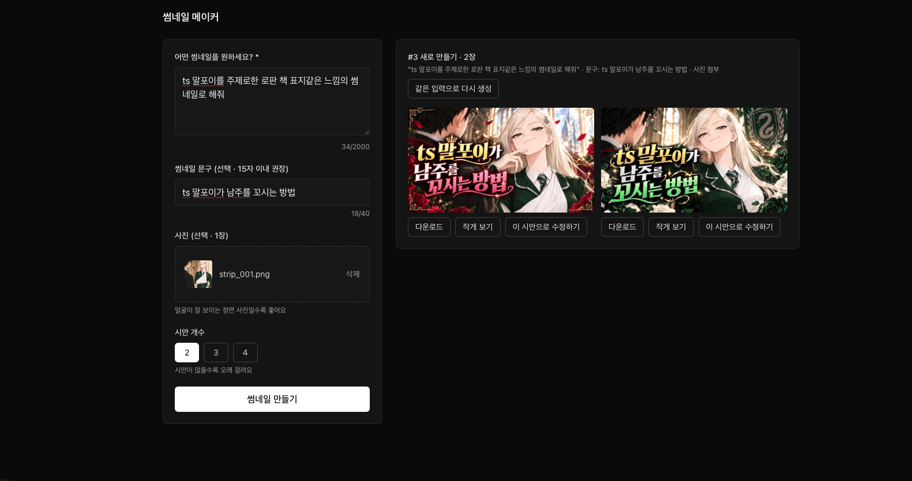
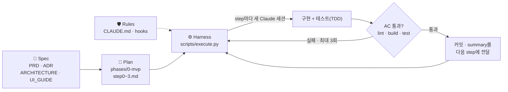

# 🎬 썸네일 메이커 (thumbnail-maker)

> 말하듯 설명하면, 클릭을 부르는 유튜브 썸네일 시안이 나옵니다.

<p align="center">
  
  
</p>
<p align="center"><sub>실제 생성 결과 · 프롬프트 "ts 말포이를 주제로한 로판 책 표지같은 느낌의 썸네일로 해줘" + 문구 + 사진 1장 → 1280×720 JPEG 2장</sub></p>



이 저장소는 **SDD(Spec-Driven Development)** 실험 프로젝트입니다. 사람은 스펙(문서)만 썼고, 구현 코드는 그 스펙을 받은 AI 에이전트가 하네스를 통해 단계별로 작성했습니다.

---

## 무엇을 하나요

디자인 툴에 익숙하지 않은 유튜브 크리에이터가 영상마다 빠르게 썸네일을 뽑을 수 있는 MVP 웹 서비스입니다.

| | 기능 | 설명 |
|---|---|---|
| ✍️ | **생성** | 설명(필수) + 썸네일 문구(선택) + 사진 1장(선택) + 시안 개수(2~4)로 1280×720 시안을 만듭니다 |
| 🔁 | **비교와 개선** | 결과가 라운드 카드로 쌓입니다. 같은 입력으로 다시 생성하거나, 마음에 드는 시안을 골라 수정 요청으로 다듬습니다 |
| 🔍 | **작게 보기** | 유튜브 목록 크기로 줄여 문구가 읽히는지 확인합니다 |
| ⬇️ | **다운로드** | `thumbnail-{라운드}-{순번}.jpg`로 바로 내려받습니다 |

**만들 때 지킨 원칙**
- **입력은 절대 지우지 않습니다.** 성공·실패·취소 어떤 경우에도 폼 값을 보존해 바로 고쳐서 다시 만들 수 있습니다.
- **서버는 아무것도 저장하지 않습니다(stateless).** 업로드 사진과 결과 이미지는 브라우저 메모리에만 있습니다.
- **API 키는 서버에만 둡니다.** OpenAI SDK는 `src/services/thumbnail.ts` 한 곳에서만 호출합니다.
- **에러는 사람의 말로 알려줍니다.** OpenAI 원문 에러 대신 한국어 안내와 "다시 시도할 수 있는지" 여부만 보여줍니다.

---

## SDD(Spec-Driven Development)란

> **코드가 아니라 스펙이 진실의 원천이다.**
> 사람은 *무엇을, 왜, 어디까지* 만들지 문서로 정하고, AI는 그 문서를 계약서로 삼아 *어떻게* 를 구현한다.

바이브 코딩이 "대화하면서 그때그때 고치는" 방식이라면, SDD는 **대화 전에 합의된 스펙을 먼저 고정**합니다. 그래서 결과가 세션마다 흔들리지 않고, 사람이 먼저 리뷰할 대상도 코드(이 저장소 기준 테스트 포함 약 2,600줄)가 아니라 스펙(약 450줄)이 됩니다.

### 이 저장소의 4개 레이어



| 레이어 | 파일 | 역할 |
|---|---|---|
| **Spec** — 무엇을·왜 | [`docs/PRD.md`](docs/PRD.md), [`docs/ADR.md`](docs/ADR.md), [`docs/ARCHITECTURE.md`](docs/ARCHITECTURE.md), [`docs/UI_GUIDE.md`](docs/UI_GUIDE.md) | 사용자 여정, 화면, 에러 메시지 문구, API 계약, 파일 구성과 함수 시그니처까지 확정 |
| **Rules** — 넘지 말 선 | [`CLAUDE.md`](CLAUDE.md), [`.claude/hooks/`](.claude/hooks) | CRITICAL 규칙(키 노출 금지, 입력 보존, 무저장, 파일 추가 금지), 테스트 없는 구현 차단(TDD guard), 위험 명령 차단 |
| **Plan** — 쪼개기 | [`phases/0-mvp/`](phases/0-mvp) | step 하나 = 레이어 하나. 각 step은 외부 맥락 없이 읽히도록 자기완결적으로 쓰고, 검증은 실행 가능한 커맨드(AC)로 정의 |
| **Harness** — 실행 | [`scripts/execute.py`](scripts/execute.py) | 브랜치 생성, 매 step에 스펙·규칙 주입, 이전 step 요약 누적, 실패 시 에러를 피드백하며 최대 3회 재시도, 코드/메타데이터 분리 커밋 |

### 핵심 요지
1. **스펙을 먼저, 구체적으로.** "에러를 잘 처리해라"가 아니라 상황별 HTTP status·문구·재시도 여부까지 표로 고정합니다.
2. **결정은 기록으로.** 왜 이 모델·해상도·구조를 골랐는지와 포기한 것(트레이드오프)을 ADR로 남겨, 에이전트가 임의로 뒤집지 못하게 합니다.
3. **작게 쪼개고, 새 세션으로.** step마다 깨끗한 컨텍스트에서 시작하고, 필요한 정보는 전부 step 파일과 이전 step의 한 줄 요약으로만 전달합니다.
4. **"동작해야 한다" 대신 실행 가능한 검증.** 완료 기준은 `npm run build && npm run test` 같은 커맨드이고, hook이 테스트 우선(TDD)을 강제합니다.
5. **실패는 자가 교정 루프로.** 실패하면 에러 메시지를 다음 시도의 프롬프트에 넣어 다시 돌리고, 사람의 개입이 필요하면 `blocked`로 멈춥니다.

### 실행 결과 — `0-mvp` phase

| Step | 내용 | 소요 | 누적 테스트 |
|---|---|---|---|
| 0 `project-setup` | Next.js 16 · Tailwind v4 · Vitest + RTL 스캐폴딩 | 약 4분 | — |
| 1 `thumbnail-api` | 입력 검증, OpenAI 서비스, `POST /api/thumbnails` | 약 6분 | 88 |
| 2 `ui-components` | `ThumbnailForm`, `RoundCard` 표현 컴포넌트 | 약 13분 | 129 |
| 3 `studio-page` | 상태를 가진 `ThumbnailStudio`, 페이지 연결 | 약 8분 | 146 |

**4개 step · 약 30분 · 재시도 0회 · 테스트 146개 통과.** `src/` 아래 구현 코드는 모두 하네스가 띄운 Claude 세션이 작성했습니다.

---

## 시작하기

```bash
npm install
cp .env.example .env.local   # OPENAI_API_KEY=sk-... 입력
npm run dev                  # http://localhost:3000
```

| 명령어 | 설명 |
|---|---|
| `npm run dev` | 개발 서버 |
| `npm run build` | 프로덕션 빌드 |
| `npm run lint` | ESLint |
| `npm run test` | 테스트 (Vitest, OpenAI SDK는 mock) |
| `python3 scripts/execute.py <phase>` | 하네스로 phase의 step을 순차 실행 |

## 기술 스택

Next.js 16 (App Router) · TypeScript strict · Tailwind CSS v4 · Vitest + React Testing Library · OpenAI Node SDK (`gpt-image-2.5-flare`, 1280×720 JPEG)

## 구조

```
docs/            스펙 (PRD · ADR · ARCHITECTURE · UI_GUIDE)
phases/0-mvp/    하네스 step 정의와 실행 상태(index.json)
scripts/         하네스 실행기 execute.py
src/
├── app/                     page.tsx, layout.tsx, api/thumbnails/route.ts
├── components/              ThumbnailStudio · ThumbnailForm · RoundCard
├── lib/validation.ts        입력 검증 (서버·클라이언트 공용)
├── services/thumbnail.ts    프롬프트 구성 · OpenAI 호출 · 에러 변환
└── types/thumbnail.ts       공용 타입
```
